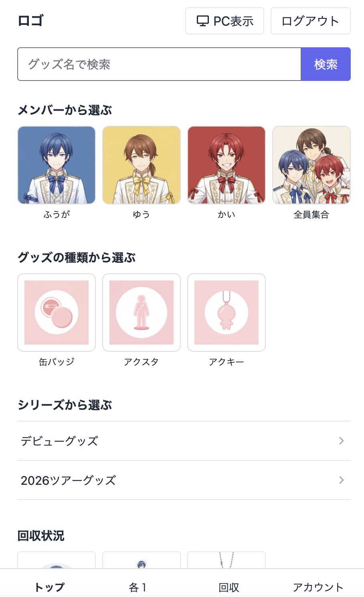
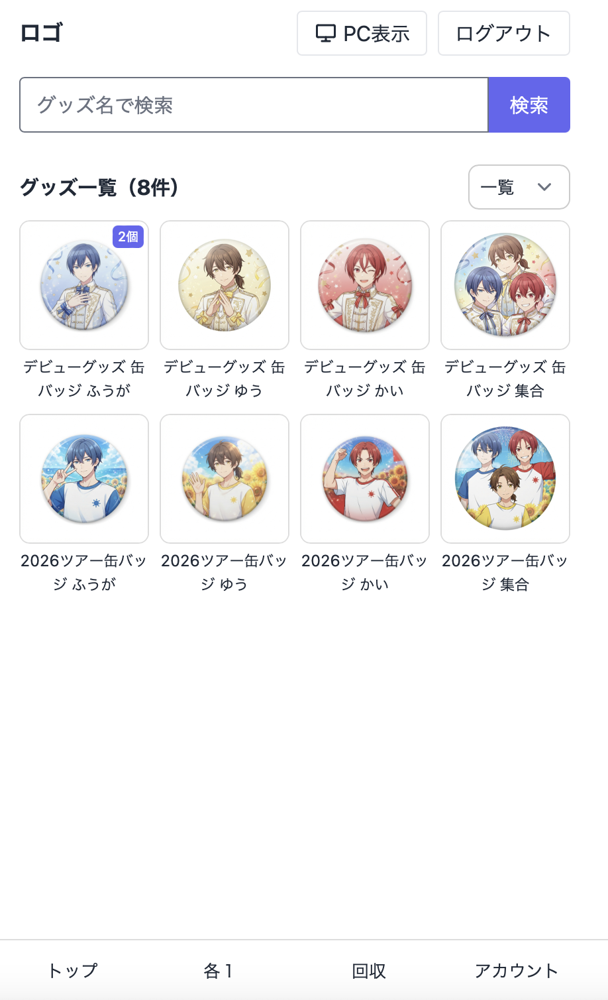
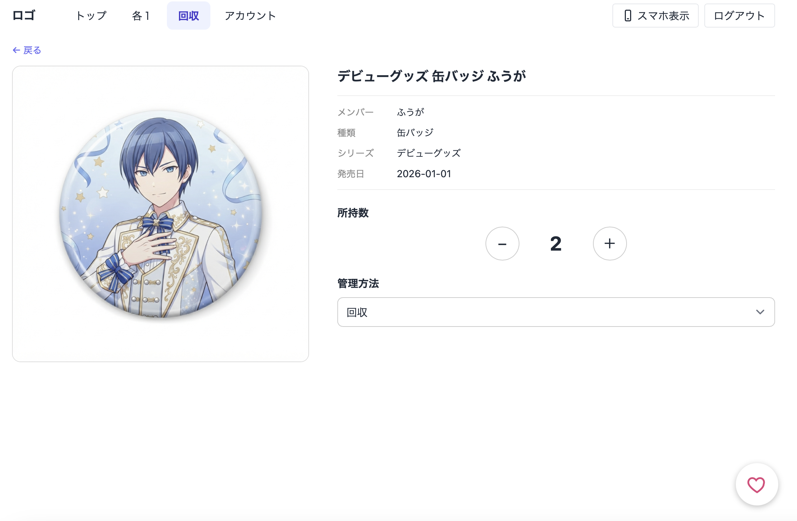
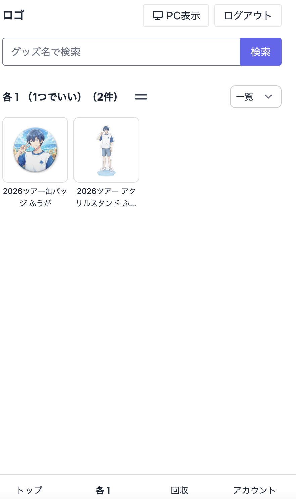

# 推しグッズ管理アプリ

## プロジェクト概要
推しグループのグッズを管理できるwebアプリケーションです。
グッズの情報と写真はあらかじめ登録されていて、ユーザーは「持っている数」と「保管方法(未選択/各１/回収)」を記録します。
お店やイベント会場でスマホから検索して、持っているかどうかをすぐに確認でき、二重買いを防げます。

**公開URL:** https://app.babunoballoon.com
**設計書:** docs/

### 解決したい課題
- 一つだけ欲しいグッズを持っているのに忘れて二重に買ってしまう。
- たくさん集めているグッズが今いくつあるかわからない
- お店でスマホのメモや写真フォルダを探すのに時間がかかる

## 主な機能
- ユーザー登録・ログイン・ログアウト・パスワード再設定
- グッズ一覧・詳細表示
- 所持状況の登録・更新・削除
- Policyによる権限管理
- キーワード検索・メンバー/種類での絞り込み
- 所持数の+/-ボタン(Ajax、ページを再読み込みしない)
- 欲しい！機能(Ajax、グッズ詳細の右下のボタン)
- まとめて各１に登録
- トップページから、メンバー・種類・シリーズ・回収状況を確認

## 技術スタック

### バックエンド
- PHP 8.2
- Laravel
- MySQL 8.4

### フロントエンド
- Blade
- Tailwind CSS
- JavaScript

### インフラ
- Docker
- 本番環境：AWS
- AWS RDS
- Nginx

### 開発ツール
- GitHub
- Claude Code
- Laravel

## セットアップ方法

### 1.リポジトリのクローン
```bash
git clone https://github.com/yuayuasakura/project1.git
cd project1   # Laravel は src/、設計書は docs/ にある
```

### 2.依存関係のインストール
```bash
docker compose up -d
docker compose exec app composer install
cd src && npm install && cd ..   # ホストPCで実行（appコンテナにはNode.jsが入っていないため）
```

### 3.環境設定
```bash
cp src/.env.example src/.env
docker compose exec app php artisan key:generate
```

### 4.データベース設定
`src/.env` ファイルを編集:
```
DB_CONNECTION=mysql
DB_HOST=db
DB_PORT=3306
DB_DATABASE=laravel
DB_USERNAME=root
DB_PASSWORD=secret
```

### 5.マイグレーション
```bash
docker compose exec app php artisan migrate --seed
```

### 6.ストレージリンク作成
```bash
docker compose exec app php artisan storage:link
```

### 7.開発サーバー起動
```bash
docker compose up -d   # 2. で起動済みなら不要
cd src && npm run dev   # ホストPCで実行
```

アプリケーションはブラウザで localhost にアクセスすると表示されます（nginxの80番ポート）。

## スクリーンショット

### トップページ


### グッズ一覧(トップページから「グッズの種類で選ぶ」の「缶バッジ」を選択)


### グッズ詳細


### 各１ページ


## 工夫した点
1.お店でスマホから使いやすいUI
- トップページの一番上に検索欄を起き、すぐに検索できるようにした
- 画面の下にメニューを固定し、片手で画面を移動できるようにした
- 欲しい！ボタンをグッズ詳細の右下に固定し、スクロールしても押せるようにした
- ボタンを大きめにして推しやすくした

2.推し活の集め方に合わせた機能
- 保管方法を「未選択/各１/回収」の三つに分け、集め方の違いに対応した
- 「このメンバーの缶バッジは全部各１」という集め方が多いため、メンバーと種類を選んでまとめて登録できるようにした
- ペルソナを2人作り、機能の優先順位を決めた

3.快適な操作感
- 所持数の+/-と欲しい！はページを再読み込みせずにすぐ反映する
- サーバーから帰ってきたJsonの値で画面を書き換え、画面とデータベースがずれないようにした

4.セキュリティ対策
- Policyで自分の所持状況・欲しい！だけ操作できるようにした
- CSRF、XSS対策、SQLインジェクション対策

5.データ設計とパフォーマンス
- メンバー・種類・シリーズを別のテーブルに分けた
- まとめて各１に登録するときはDBトランザクションで途中失敗を防いだ


## 今後の拡張予定
- 目標回収個数の登録と回収率の表示
- 今後発売されるグッズも自動で各１に設定する機能
- 曖昧単語検索(「アクリルスタンド」は「アクリルスタンド」でしか出てこないので、「アクスタ」でも調べられるようにする)

## 学習記録
このプロジェクトはtechmeetsのAI駆動開発カリキュラムの集大成として作成しました。

### 習得した技術
- Laravel
- Ajax
- Docker
- GitHub
- AWS
- CI/CD
- 設計

## 作成者
- GitHUb:[@yuayuasakura](https://github.com/yuayuasakura)

